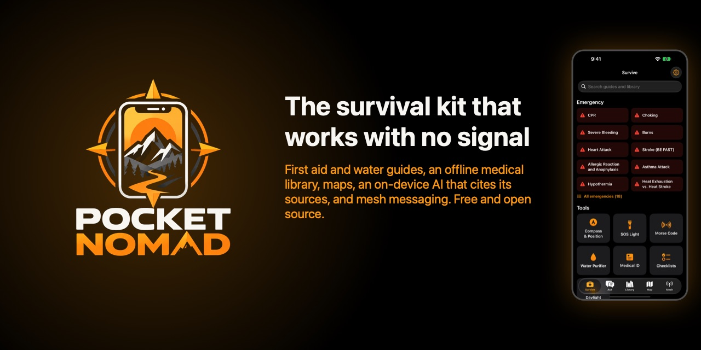
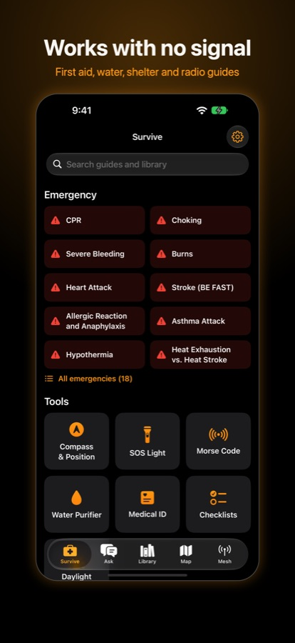
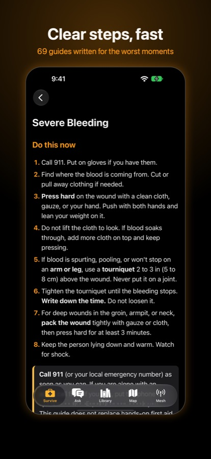
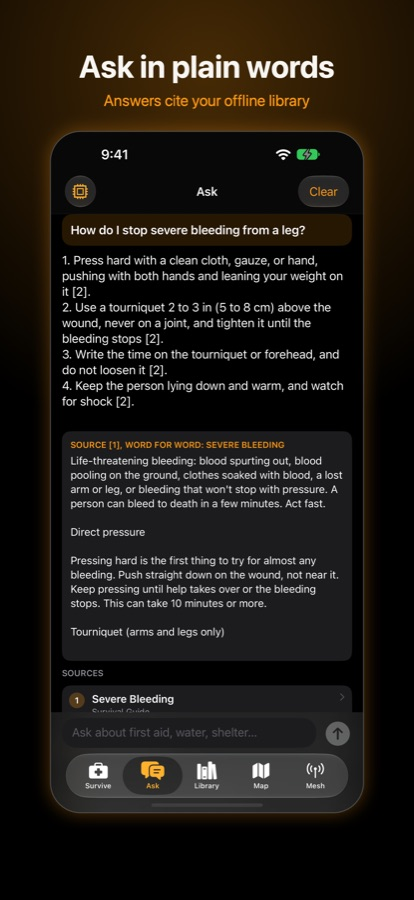
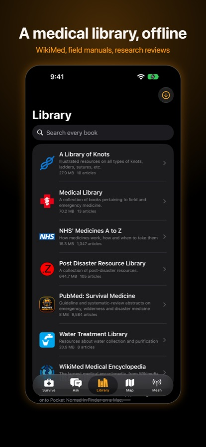
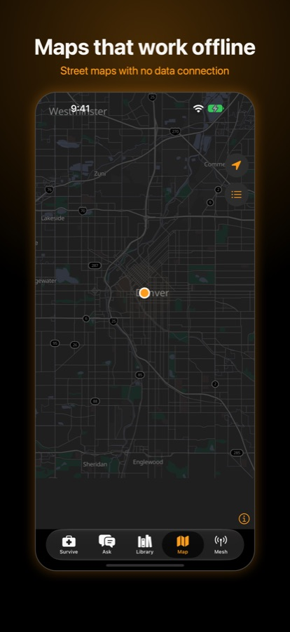
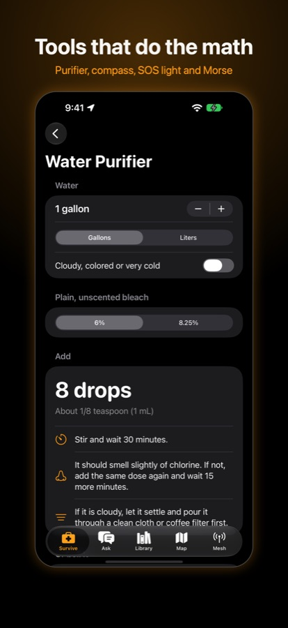

Most of the apps on your phone stop being useful the moment the bars go away. That's
exactly when you might need to stop bleeding, make water safe to drink, find your way out, or
reach someone. So I built an app for that moment: **Pocket Nomad**, a free, open-source
survival kit for iPhone that works with no signal at all.

It has its own home now: **[pocketnomad.us](https://www.pocketnomad.us/)**.

<figure style="margin:1.5rem 0;">
  
</figure>

## What's in it

Five tabs, and everything in them is on the phone before you need it.

- **Survive.** 69 step-by-step guides for the worst moments: CPR, choking, severe bleeding,
  burns, stroke, hypothermia, heat stroke and more, written as short numbered steps you can
  follow with shaking hands. Plus tools: a compass with your position, an SOS light, Morse
  code, a water purifier calculator, a medical ID, and checklists.
- **Ask.** Type a question in plain words and an AI that runs entirely on your phone answers
  it, citing the guide or book each step came from, with the source text right underneath.
  No server, no account, nothing sent anywhere.
- **Library.** Whole reference books, offline: WikiMed, the NHS medicines A to Z, field
  medical manuals, water treatment, knots, a post-disaster resource library, and a PubMed
  pack of almost 10,000 research summaries on emergency and wilderness medicine.
- **Map.** Real street maps that work with no data connection. Download your region (I carry
  all of Texas) and it follows your GPS like any other map.
- **Mesh.** Text with people nearby when there's no cell network at all, through a small
  LoRa radio paired over Bluetooth. More on that below.

  
  
  
  
  
  

## Texting with no towers

The Mesh tab talks to the two popular open radio systems, **Meshtastic** and **MeshCore**,
and figures out which one your radio runs on its own. Messages hop from radio to radio, so
the range grows with every radio in the area. There's an SOS button that can include your
coordinates, and the radios other people carry show up on the offline map.

My first radio, a Heltec V4 that costs about $30, came in this week. It's flashed, paired
with the app and sending. Next up: a second radio to test both systems side by side, a
3D-printed pocket case with a built-in battery and wireless charging, and a solar repeater
on top of a painter's pole to push the range out. I'll write those up as they get built.

The app can also record a **coverage map**: every time your radio hears another one, it
notes where you were and how strong the signal was, so you can see where the mesh reaches
and where a repeater would help. It's off until you turn it on. Sharing is a separate
switch, and it can't be turned on until you mark private zones like your home. Even then,
nothing leaves the phone unless you export the file yourself, after the app strips names,
exact positions and anything near those zones.

## Private by design

No accounts, no analytics, no ads, no tracking, and no servers. Your medical ID, messages,
pins and checklists stay on your phone. The only time it touches the internet is when you
ask it to download a book, a map or an AI model.

## Free and open source

Pocket Nomad is free and the code is public on
[GitHub](https://github.com/dougray/pocket-nomad) under the Apache 2.0 license, so anyone
can read it, check those privacy claims, or build on it. It isn't in the App Store yet;
[pocketnomad.us](https://www.pocketnomad.us/) will say when it is.

One honest note: the guides are written carefully from published first-aid sources, but
they're getting a medical review before I'd call them finished, and no app replaces real
first-aid training. If you've been meaning to take a class, this is your sign.
