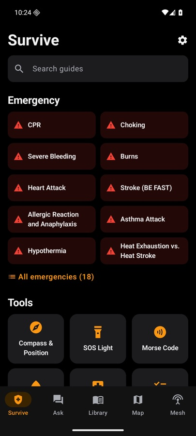
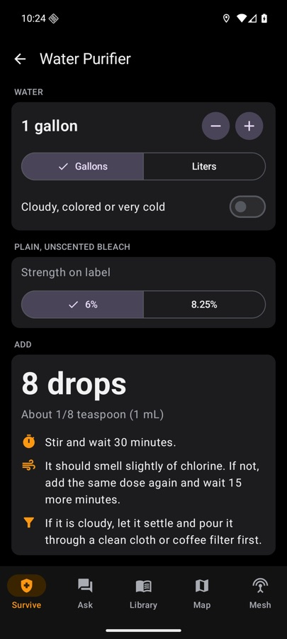
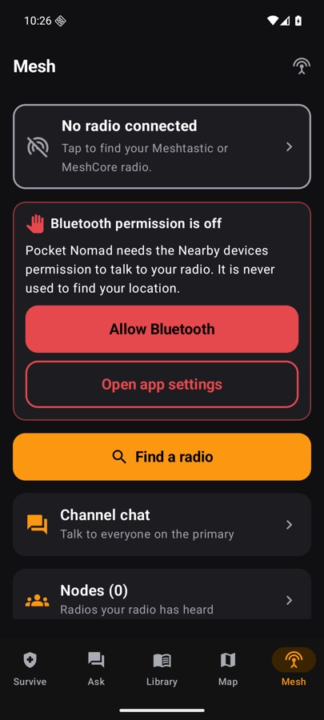
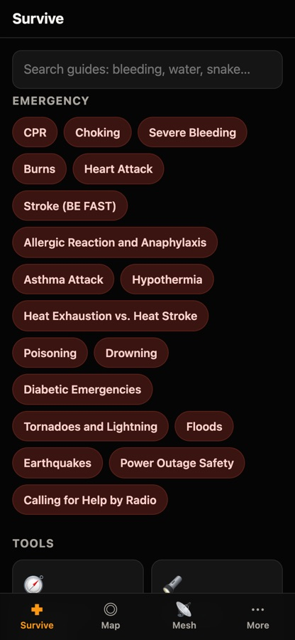
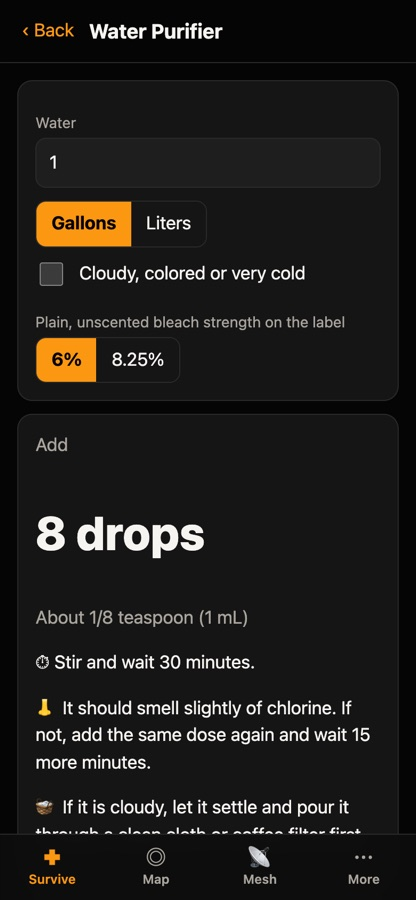
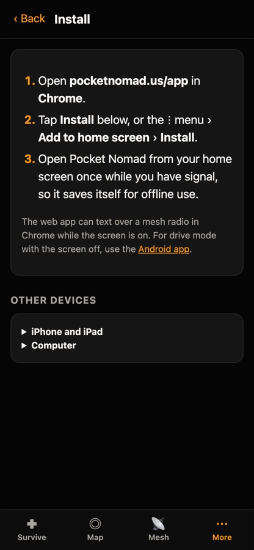
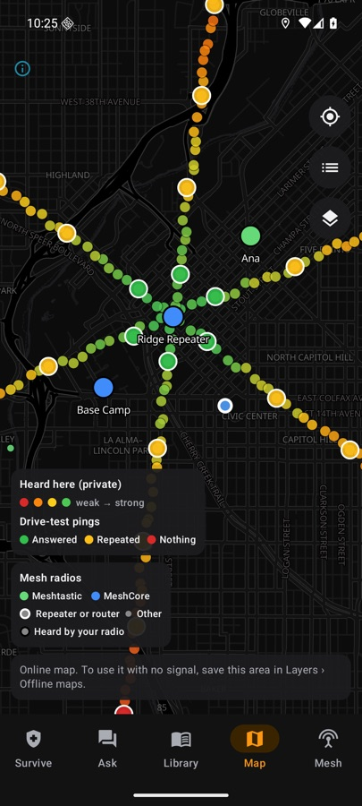

Yesterday I introduced **[Pocket Nomad](https://www.pocketnomad.us/)**, a free, open-source
survival kit for your phone that works with no signal. It was iPhone only. As of today it runs
on **Android** too, and on **any phone or computer through your web browser**. Same guides,
same tools, same rule: everything lives on your device, with no account and no tracking.

## Three ways to get it

- **iPhone, iPad and Apple Watch.** The full app: offline books, an on-device AI that cites its
  sources, mesh radio texting and the new drive mode below. It's on its way to the App Store;
  [pocketnomad.us/ios](https://www.pocketnomad.us/ios/) will link to it when it's live.
- **Android.** A beta you can install today. Download the APK from
  [pocketnomad.us/android](https://www.pocketnomad.us/android/), which walks you through it
  step by step. Google Play is next.
- **Web app.** Open [pocketnomad.us/app](https://www.pocketnomad.us/app/) and add it to your home
  screen. It takes ten seconds, works on iPhone, Android, Windows and Mac, and keeps working
  with no signal once it's installed.
  [The install steps for each device are here](https://www.pocketnomad.us/pwa/).

Each of those pages has the same side-by-side table of what every version can do, so you can
pick the one that fits.

  
  
  
  
  
  

## Map the mesh from your car

The mesh side got a big upgrade, built around one question: *where does my radio actually work?*

- **Drive mode** keeps mapping with the phone locked in a car mount. It uses your phone's own
  GPS, so the radio doesn't need one, and it turns itself off after four hours.
- **The ping test** sends a tiny test message every 300 meters and colors the spot: **green**
  if the radio you pinged answered, **yellow** if another radio passed it along, **red** if
  nothing heard you. That's the difference between "I could hear the mesh here" and "my
  messages get through here."
- **Known radios.** One tap downloads the public lists of Meshtastic and MeshCore radios
  near you from the community maps at meshmap.net and map.meshcore.io, and shows them on your
  offline map. Meshtastic in green, MeshCore in blue, repeaters ringed. Around where I live, that's
  hundreds of MeshCore repeaters I had no idea were there. Anyone who puts ⛔, 🛑 or 🚫 in
  their radio's name is left off, which is the community's "don't map me" sign.

If you choose to share your coverage, it goes to the public
[coverage map](https://www.pocketnomad.us/coverage/), which now has a "two-way pings" view.
Your home and any other private places you mark are always cut out first.

<figure style="margin:1.5rem 0;">
  
  <figcaption style="text-align:center;font-size:.9em;color:#828282;">Demo data: coverage dots, ping results and mesh radios on the Android map.</figcaption>
</figure>

## The guides got a second look

Last time I said the first-aid guides needed a medical review before I'd call them finished. I
couldn't wait for that to start the work, so I went back to the sources themselves: the full
2024 American Heart Association and Red Cross first-aid guidelines, the European 2025
guidelines, the Wilderness Medical Society, **NOLS** and the CDC and EPA. That pass changed 15
guides. A few examples:

- **Low blood sugar:** the old "4 ounces of juice" was too little. It's now about 20 grams of
  sugar (6 to 8 ounces of juice), and call 911 if they aren't better in 10 minutes.
- **Neck and back injuries:** if the person is awake, let them hold their own head the way
  that feels best. Don't force it, and never use a neck collar.
- **Water:** boil for 3 minutes above 5,000 feet, the EPA's more cautious number.
- **Radio:** fixed a few FCC details, including who can actually use ham frequencies in an
  emergency.

Everything that was checked, what changed and why is published at
[pocketnomad.us/MEDICAL-REVIEW](https://www.pocketnomad.us/MEDICAL-REVIEW.html). One question
is still open, on snakebite. If you're an EMT, paramedic, nurse or wilderness first responder
and have 15 minutes,
[I'd love your eyes on it](https://github.com/dougray/pocket-nomad/issues).

## Help me test it

The Android app and the web app's radio features have only run against simulated radios so
far. Real hardware is next on my list, but if you have a Meshtastic or MeshCore radio and an
Android phone, grab the beta and
[tell me what breaks](https://github.com/dougray/pocket-nomad/issues). Include your phone model
and Android version.

It's all free and open source under the Apache 2.0 license, on
[GitHub](https://github.com/dougray/pocket-nomad). And the same reminder as always: no app
replaces a first-aid class. If you've been meaning to take one, this is your sign.
