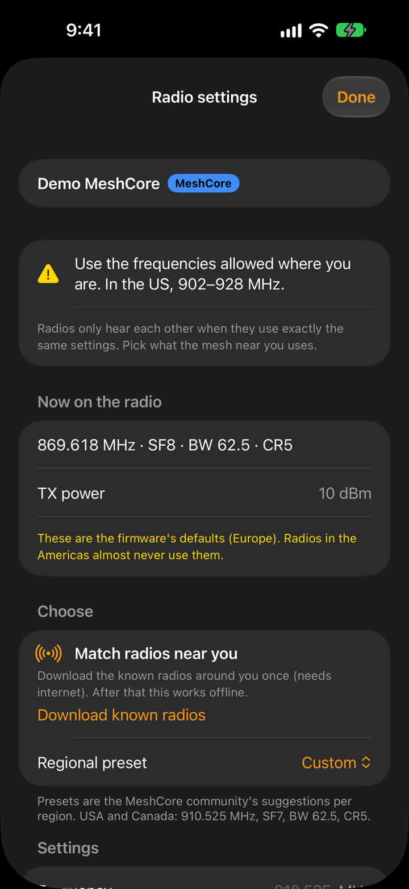
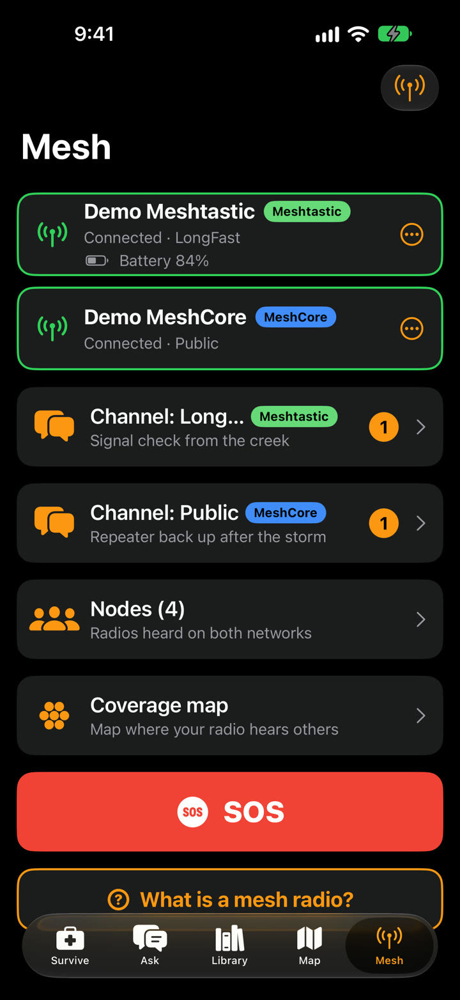
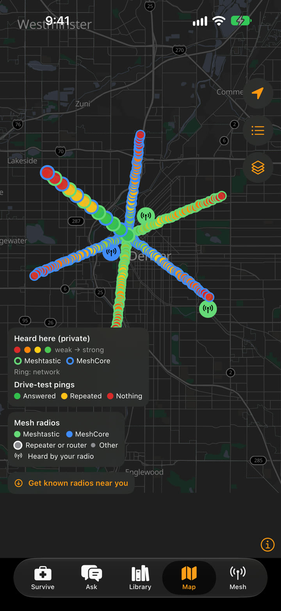

Last time I said real radios were next on my list for **[Pocket Nomad](https://www.pocketnomad.us/)**,
my free, open-source survival app that works with no signal. This week I finally did it: two
Heltec V4 boards, one running Meshtastic and one running MeshCore, both connected to the app
on my phone at the same time. Then I took them for a drive.

It mapped almost nothing. That turned out to be the most useful drive I could have taken.

## Problem one: the radio was listening in Europe

The first thing I noticed, sitting at my desk, was "no nodes in range." The community maps
show hundreds of MeshCore repeaters around me, so that made no sense, until I looked at the
radio's settings. A brand-new MeshCore radio ships tuned to **869.6 MHz**, the European
frequency. In the US, the mesh lives around 910 MHz. My radio was listening to an empty room.

So Pocket Nomad now has **Radio Settings** for each radio. You can see exactly what the radio
is set to, change the frequency, preset and transmit power, and the app warns you when a radio
is still on the European defaults. The easy button is **Match radios near you**: it looks at
the known radios around you and picks the settings most of them use.

<figure style="margin:1.5rem 0;">
  
  <figcaption style="text-align:center;font-size:.9em;color:var(--dcl-muted);">Demo radio still on the factory settings. The yellow line is the warning that would have saved me an evening.</figcaption>
</figure>

Once the radio was on the right frequency, it worked. On the drive it picked up a stranger's
"good morning" on the public channel, passed along by **ten** repeaters before it reached me.
That's the mesh doing exactly what it's supposed to do.

## Problem two: the map stayed empty

Afterwards I pulled the drive data off the phone and found **zero** coverage points and a single
ping. Two things were wrong:

- **The app was ignoring most of what the radio heard.** A MeshCore radio reports every
  packet it picks up, including all the traffic repeaters pass along. That is the best signal
  there is for "the mesh reaches here," and Pocket Nomad was only counting the rare moments a
  radio announced itself or a message arrived. Now **every packet becomes a point on the map**,
  credited to the repeater that's in range of you.
- **The ping test stalled.** Pings on MeshCore needed you to pick a specific person's radio,
  and drive mode could stop for good if the phone closed the app in the background (say,
  while you're using navigation). Now MeshCore pings **trace the nearest repeater** you've
  heard, which repeaters answer on their own with no setup, and drive mode **picks itself back
  up** if the phone closes the app.

Two smaller fixes came out of the same digging. Coverage now saves properly while the phone is
locked, which is how you actually drive. And there's a new **drive log** that stays on the phone:
when drive mode started and stopped and why, radios connecting and dropping, every ping, and a
check-in every minute. It never records where you were. The next time a drive maps nothing,
I'll know exactly why instead of guessing.

  
  

## Get it

- **Android:** the new [0.4.0 beta](https://www.pocketnomad.us/android/) has all of this, plus
  the Wear OS app. Install it over the old one; your data stays.
- **iPhone, iPad and Apple Watch:** on its way to the App Store;
  [pocketnomad.us/ios](https://www.pocketnomad.us/ios/) will link to it when it's live.
- **Web app:** [pocketnomad.us/app](https://www.pocketnomad.us/app/) for the guides and tools on
  any phone or computer.

## Help me test it

The fixes pass their tests, but the real proof is the next drive, and I'm only one guy with two
radios. If you have a Meshtastic or MeshCore radio, turn on drive mode, take a drive, and
[tell me what you see](https://github.com/dougray/pocket-nomad/issues). Include your phone model
and your radio.

It's all free and open source under the Apache 2.0 license, on
[GitHub](https://github.com/dougray/pocket-nomad). And if you just bought a MeshCore radio and
can't hear anyone: check the frequency first.
