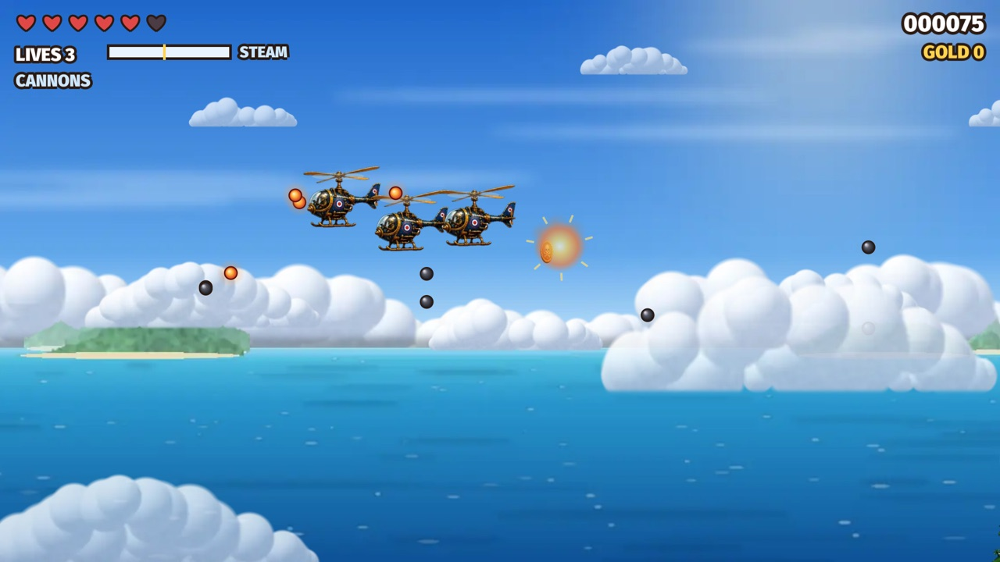
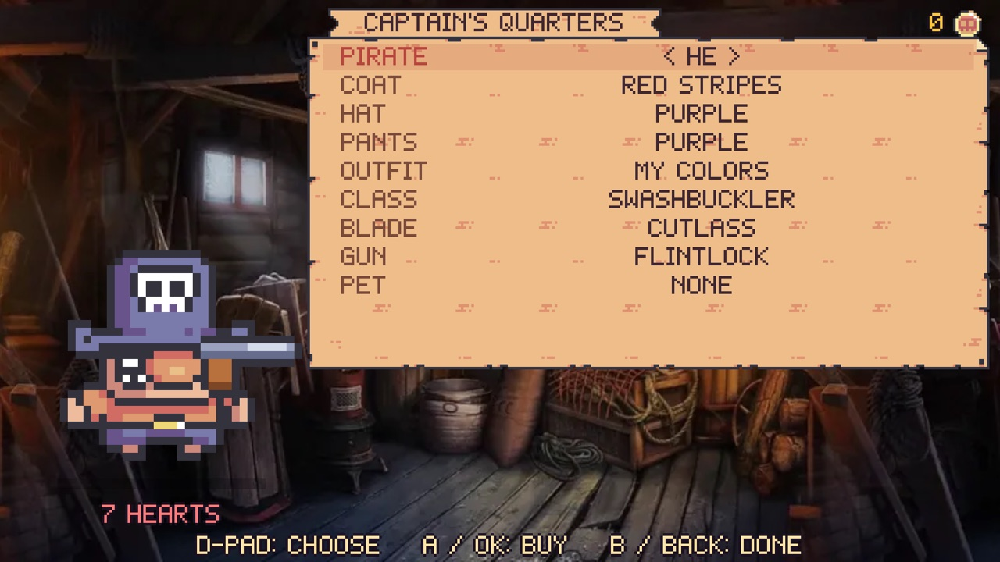
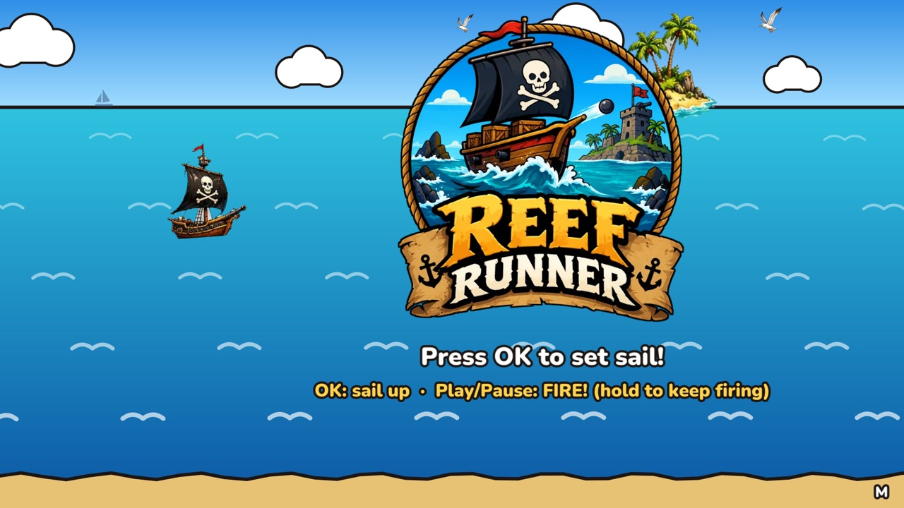

Some news from the harbor: **Plunder Bay Entertainment is now a registered Nintendo developer.**
Nintendo accepted the application, the paperwork is signed, and the three pirate games are
working toward a new port of call: **Nintendo Switch**.

"Working toward" is the honest phrase. There is no release date yet, and there is a lot of
sailing left before one. Here's where things stand.

## Why Switch

Reef Runner, Jolly Rogue and Cloud Dancer were built to be played with whatever you have in your
hand: a phone, a tablet, a browser, a game controller, even an Apple TV remote. A handheld that
docks to the TV is the perfect fit for short pirate runs on the couch or on the go.

## The hard part: a new engine

The games are written in JavaScript and draw to a web canvas. That's why they run in any
browser, and why the iPhone and Android apps are small. A game console doesn't come with a web
browser to run them in, so the plan was never to rewrite three games. Instead, I built a small
native engine that runs the **same game code, unchanged**.

It's written in C++ and does the jobs a browser normally does: it runs the JavaScript, draws the
shapes and painted art on the graphics chip, plays the music and sound effects, saves your
progress and reads the controller. It grew out of the engine that already runs the Apple TV
versions.

All three games already run start to finish in it on my Mac, and the automated tests compare
every frame against the versions you can play today:

<figure style="margin:1.5rem 0;">
  
  <figcaption style="font-size:0.9rem;opacity:0.75;margin-top:0.4rem;">Cloud Dancer in the new engine, on the Mac.</figcaption>
</figure>

<figure style="margin:1.5rem 0;">
  
  <figcaption style="font-size:0.9rem;opacity:0.75;margin-top:0.4rem;">Jolly Rogue's Captain's Quarters, already set up for buttons and a D-pad.</figcaption>
</figure>

<figure style="margin:1.5rem 0;">
  
  <figcaption style="font-size:0.9rem;opacity:0.75;margin-top:0.4rem;">Reef Runner, ready to set sail.</figcaption>
</figure>

## What's next

1. **Get the games running on Nintendo's hardware.** The engine was built so that only a thin
   layer has to change for a new platform. That layer is next.
2. **Make them fast enough.** Reef Runner draws a lot of shapes every frame, and that's the part
   I'm speeding up right now so it holds a smooth 60 frames a second on a handheld.
3. **Meet Nintendo's requirements** for things like sleep mode, saving and controllers.
4. **Get approval to publish.** Developing a game and releasing it are separate steps with
   Nintendo, and releasing comes last.

## What this doesn't change

- **The games stay free**, with no ads and no tracking, on every platform.
- **Nothing changes for the other platforms.** You can keep playing in the browser at
  [reefrunner.us](https://reefrunner.us/), and the iPhone, iPad, Apple TV and Android versions
  carry on.
- **You can still join the official beta** on iPhone, iPad, Apple TV and Android at
  [reefrunner.us/beta](https://reefrunner.us/beta/).

Being a Nintendo developer comes with a non-disclosure agreement, so I won't be sharing details
of Nintendo's tools. I'll post progress on the games themselves as it happens, and the day
there's a real date, you'll read it here first.

Nintendo Switch is a trademark of Nintendo. Plunder Bay Entertainment is an independent developer, and this post is not affiliated with or endorsed by Nintendo.

